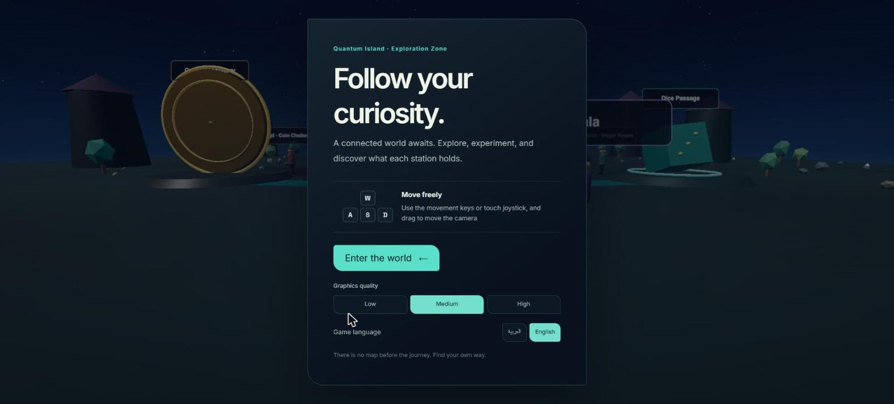
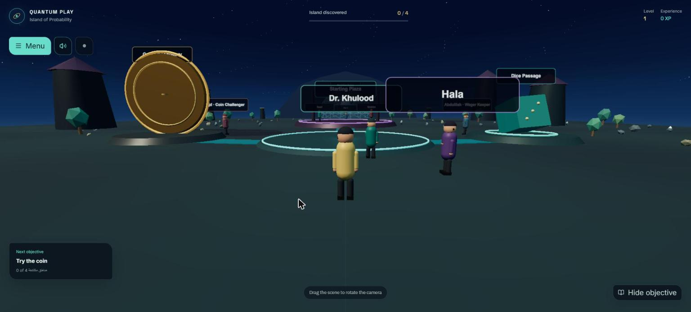
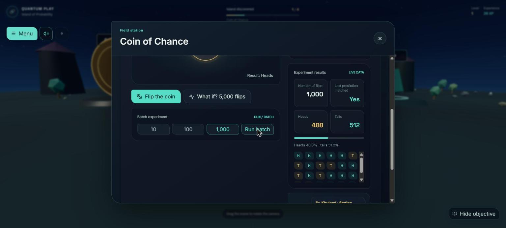
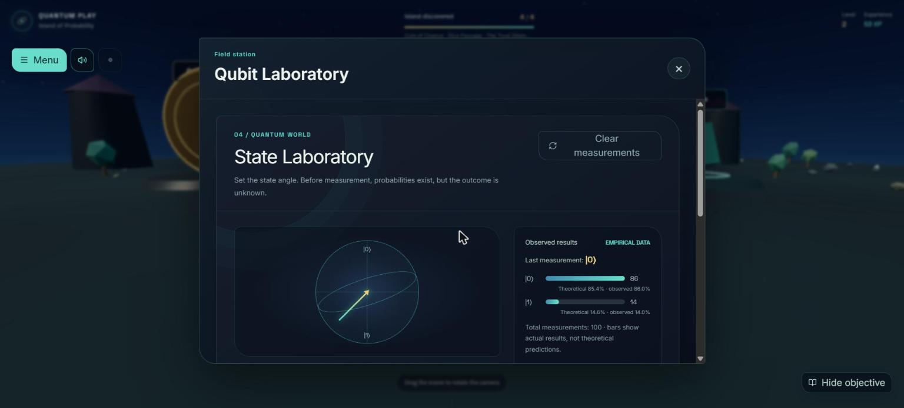
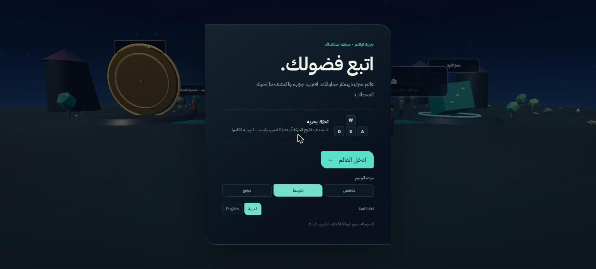

# QUANTUM PLAY | لعبة الاحتمالات

**Deployment-build backup.** A 3D, bilingual (Arabic / English) browser game set on an "Island of
Probability", where players visit four stations that teach probability and quantum measurement through
hands-on experiments.

**Live demo:** <https://quantum-play.replit.app/>

> **This repository is a backup of the deployed build, not the original development source code.**
> It holds a byte-identical copy of the minified build that was served at the live demo on 2026-11-23.
> The original source code and development history were not available when this backup was made.
> Nothing was reconstructed, no source files were invented, and no commits from the original project are
> included or implied. The single commit here is labelled as a deployment-build backup.



## Features

Observed by running this exact snapshot in a browser on 2026-11-23:

- **3D island world.** A low-poly island with named characters and four experiment stations. The in-game
  *Controls* menu lists: W A S D (or a touch joystick) to move relative to the camera, mouse/touch drag to
  turn the camera, Shift to run, Space to jump, E to interact with nearby characters, Esc to close menus.
  The HUD shows an island-discovery counter, level, XP and a next-objective card.
- **Four stations**, reachable on foot or from the in-game *Experiments* menu:
  1. **Coin of Chance** — predict heads or tails, flip once or run batches of 10 / 100 / 1,000 (plus a
     5,000-flip "what if"), and watch live counts. A 1,000-flip batch run during this backup gave 488 heads
     and 512 tails.
  2. **Dice Passage** — pick a face from 1 to 6 and place a virtual wager from a 100-point balance
     (correct face pays 5× the wager, otherwise the wager is lost); decision history is kept.
  3. **The Trust Dilemma** — a game-theory round where you choose at the same time as another character
     (one trusts first, one follows the moment, one learns from you), and both choices are revealed together.
  4. **Qubit Laboratory** — set a qubit's state angle, see the theoretical probabilities of |0⟩ and |1⟩, then
     take 1, 10 or 100 measurements and compare observed results with theory. A 100-measurement run at
     45° gave 86 and 14 against the theoretical 85.4% and 14.6%.
- **Progression.** Levels and XP, six achievements (first coin experiment, one hundred attempts, successful
  wager, a start to trust, first quantum measurement, island explorer), and an in-game menu with Home,
  Objectives, Experiments, Achievements, Statistics, Map, Settings and Controls.
- **Bilingual interface.** Arabic (right-to-left) and English (left-to-right), switchable on the start
  screen; the page's `lang` and `dir` change with it.
- **Settings and saved state.** Graphics quality (low / medium / high), a sound toggle and pointer lock.
  Progress, graphics quality and language are saved in the browser's `localStorage`.









## Technologies identified from the deployed build

| Area | Identified |
|---|---|
| UI | React 19.1.0 |
| 3D | three.js r187 (WebGL), used directly without react-three-fiber |
| Styling | Tailwind CSS utility classes; Inter font loaded from Google Fonts |
| Icons | lucide-react |
| Audio | Web Audio API (oscillator-based; the build ships no audio files) |
| Build | Vite-style ES-module bundle: hashed `assets/` files and a separate three.js vendor chunk |
| Hosting | Replit Deployment serving a static front end; no API calls found in the client code |
| Storage | Browser `localStorage`: `quantum-play-progress-v1`, `quantum-play-graphics-quality-v1`, `quantum-play-language-v1` |

These come from the minified files only; versions are the ones embedded in the bundles.

## Run this backup locally

Needs Python 3 and a WebGL-capable browser (any static file server works):

```bash
git clone https://github.com/I9797l/quantum-play.git
cd quantum-play
python -m http.server 8001 --directory site
```

Open <http://127.0.0.1:8001/>.

- `site/index.html` contains a `<script src="https://i.replit.com/script.js" ...>` tag that Replit injected
  while serving the page; it is not part of the app's own code. Opening the page as-is loads that script
  from Replit, which may report a visit to the app owner's analytics. To avoid that, serve a *copy* of
  `site/` with that one line removed, and do not edit the archived file.
- The Inter font is loaded from Google Fonts. Offline, the browser falls back to another font.

## Repository contents

| Path | What it is |
|---|---|
| `site/` | The 6 deployed files, exactly as served: `index.html`, `favicon.svg`, `robots.txt` and `assets/` (two JavaScript bundles and one CSS file). |
| `SHA256SUMS.txt` | SHA-256 of every file under `site/`. Check with `sha256sum -c SHA256SUMS.txt`. |
| `DEPLOYMENT-SNAPSHOT-NOT-SOURCE.md` | Provenance notes for the snapshot. |
| `NOTICE.md` | Copyright and license notices. |
| `docs/screenshots/` | Screenshots captured from this unmodified snapshot running locally. |
| `.gitattributes` | Disables line-ending conversion so the files stay byte-identical on every OS. |

Everything under `site/` is unmodified.

## What is not included

The original TypeScript/JSX source, comments and file names, `package.json` and lockfile, build
configuration, `.replit` / Nix configuration, any server code, Replit Agent history and checkpoints,
Secrets / environment variables, any assets that were not shipped in the build, and the project's git
history and authorship. None of that can be recovered from a deployed build, and no sourcemaps were
published.

## About this repository

Maintained by [@I9797l](https://github.com/I9797l) as a personal, verbatim backup of the deployed build
(prepared 2026-11-23). It makes no claim about who built the app: the build itself declares no author.

## Copyright and license attribution

No copyright or license notice appears anywhere in the deployed build, so authorship, ownership and license
terms cannot be determined from it. Treat the app as the original authors' work with all rights reserved.
This repository grants no rights and adds no license. Every file under `site/` is byte-identical to what was
served, so nothing the build contains was removed or altered. See [`NOTICE.md`](NOTICE.md).
